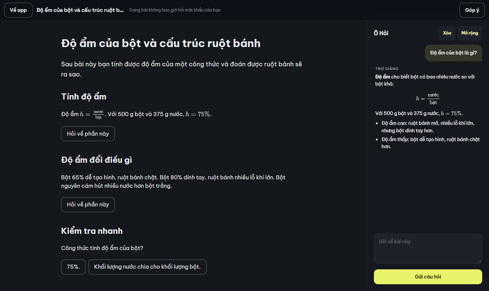
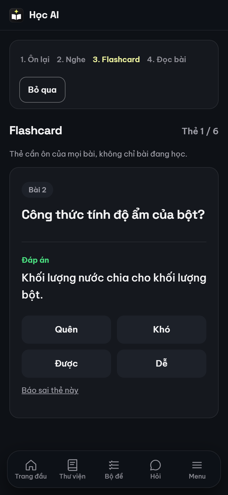
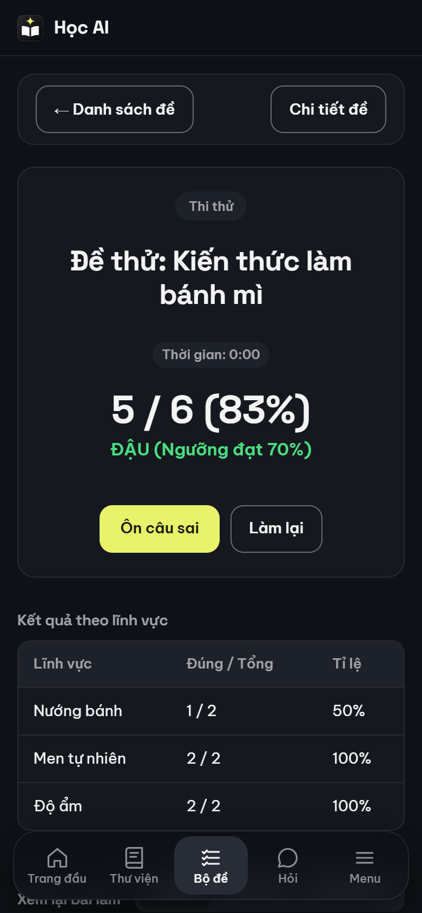

# learn-ai

A self-hosted learning app where each person uploads their own lessons and practice tests, studies them on phone or desktop, and shares them with others.



<p>
  
  
</p>

The screenshots use a made-up bread baking course and a stand-in AI answer. The interface and the design documents are in Vietnamese.

## Features

- **Study sessions:** review a summary, listen to a podcast if the lesson has audio, do spaced-repetition flashcards (FSRS), then read the full lesson page. Progress is kept per account.
- **Lesson packages:** each account uploads its own zip of up to 300 MB. Uploads go in 2 MB parts, and an update sends only new or changed files.
- **Sharing:** by email or link, with revoke and learner feedback.
- **Practice tests:** timed exams, practice with immediate feedback, review of missed questions, scores by domain, and reading aloud with a choice of speed and voice.
- **Ask box:** an AI tutor that answers from the current lesson. It stays off for a package until an admin has read the content and approved it.
- **Authoring skill:** a Claude skill, downloaded from the upload dialog, that turns notes or documents into a valid package.
- **Admin page:** accounts, Ask approval, AI provider, abuse reports, packages and a log. The database is backed up daily.

## Run locally

```
python -m venv .venv && .venv/Scripts/pip install --require-hashes -r requirements.txt
.venv/Scripts/pip install pytest httpx
.venv/Scripts/python -m pytest -q tests/test_server.py
export DATA_DIR=./data PACKAGES_DIR=./packages LINK_SECRET=local-only-secret-local-only-secret COOKIE_SECURE=0
.venv/Scripts/python -m app.cli add-user you@example.com
.venv/Scripts/python scripts/learnpkg.py pack sample/package demo.zip
.venv/Scripts/python -m app.cli import-package demo.zip you@example.com
.venv/Scripts/python -m uvicorn app.main:app --port 8000
```

Open http://127.0.0.1:8000 and log in. `add-user` prints a temporary password that must be changed at first login. This needs Python 3.12 and a POSIX shell (Git Bash on Windows). `.venv/Scripts` is the Windows path; elsewhere use `.venv/bin`. The secret and `COOKIE_SECURE=0` here are for a local run only.

## Architecture

```
Browser ── HTTPS proxy ── FastAPI (one uvicorn worker) ── SQLite (WAL)
  │                            │                     └── package files on disk
  └ lesson page in a           └ AI provider, for the Ask box only
    sandboxed iframe
```

Plain JS with no build step. Lesson pages are code written by authors, so each runs in an iframe with no origin of its own and talks to the app only through a message bridge.

In a load test on 1 CPU and 512 MB, each session saved one answer per second. With 50 sessions the app kept up, with a median of 71 ms. With 150 it topped out at 42 saves per second, with a median of 3.4 s and memory up to 470 MB. Neither run had an error, and the limit was the single Python worker, not SQLite.

## Security

Passwords are hashed with Argon2id, sessions are random tokens stored as SHA-256 in `__Host-` cookies and end sooner for admins (4 hours idle, 24 hours at most, against 7 and 30 days), login is rate limited by IP, account and pair, and the CSP allows only same-origin scripts. `cf-connecting-ip` is trusted only from the address in `TRUSTED_PROXY`.

AI answers go through DOMPurify, and each person is limited to 6 questions a minute and 50 a day by default. There is no MFA yet.

The sandbox design and its test results are in `docs/design/02a-ket-qua-sandbox.md`. Report problems through a private GitHub security advisory.

## How it was built

I built this with [Claude Code](https://claude.com/claude-code). I chose what to build and made the product and security decisions. Claude wrote most of the code, and cheaper models from other vendors wrote some of it and reviewed it. An agent saying that something works did not count as evidence, so these checks did the deciding:

- **Tests rerun independently:** more than 440 server tests run in CI, and agents' reports of passing tests were not accepted without running them again.
- **Real browsers:** eight scripts drive the running app, most of them in both Chrome and WebKit.
- **Review by a different model:** one review found that leaving a timed test could lose an answer still on its way to the server. The whole test suite was green at the time.
- **Attacks on the live site:** I ran a prompt injection test with a real model. Instructions hidden in a lesson got a harmless string into 6 of 36 answers, and 0 of 24 when the same two hiding methods carried a phishing link, image or script. After a fix to the prompt, those methods got through 0 of 12 times and the phishing link 0 of 8. This holds only for that model and those questions, so an admin must still read a package before approving it.

Some of what this caught:

- A test that failed one run in eight looked flaky. It was real loss of progress in WebKit: the lesson page's connection could drop while the page was busy, and the page then saved an empty document over the learner's data.
- The skill download broke in the Docker image because one file was not copied in. Tests run from the source tree, so they stayed green. A test now compares the file list with the `Dockerfile`.
- Taking the screenshots for this README showed black text on the dark background in pages built from the starter template. Measuring real pixels gave a contrast of 1.1:1, and the template now sets its own colours.

This is a personal project with one production deployment.

## Lesson packages

A package is a zip holding `package.json` and `lessons/<id>/`; the format is in `docs/lesson-format.md`. Check one with `scripts/learnpkg.py validate DIR [--profile full]`, zip it with `scripts/learnpkg.py pack DIR OUT.zip`, then upload it from the Library screen. The server runs the same check on every upload. `sample/package` holds a demo, and `scripts/convert_legacy.py` turns an old lesson folder into a package.

The Claude skill's zip holds one `creating-learn-packages/` folder with the instructions, a lesson template and the checker, and needs only Python unless the lesson has audio. It can be uploaded to Claude app or web, or unpacked into `~/.claude/skills/` for Claude Code.

Practice tests can be included in a package or uploaded directly as a single `.json` file (`docs/practice-test-format.md`).

## Tests

`python -m pytest -q` runs the server tests. The browser tests need `playwright` and run one at a time; most take `--browser chrome|webkit`:

- `tests/e2e_shell.py`: the app's screens and navigation
- `tests/e2e_practice.py`: practice tests
- `tests/e2e_platform.py`: upload, share, revoke, feedback
- `tests/e2e_admin.py`: the admin page and Ask approval, against a fake provider
- `tests/e2e_bridge.py`: the lesson page's bridge to the app while the page is busy
- `tests/e2e_lesson_phone.py`: the lesson page on a phone
- `tests/e2e_browser.py PACKAGE_DIR`, `tests/e2e_sandbox.py PACKAGE_DIR`: the study session and the sandbox, against an unpacked package

## Deploy

The app needs HTTPS in front of it, because session cookies are `Secure` and it sends HSTS, and lasting storage for `./data`, `./backups` and `./packages`. The included `compose.yml` runs it with Docker Compose behind a Cloudflare Tunnel, so no host port is opened. That is the only setup run in production so far; for anything else see [Other reverse proxies](#other-reverse-proxies).

Create `.env` (mode 600):

```
APP_UID=            # id -u of the deploy user
APP_GID=
PUBLIC_ORIGIN=https://your.host
ALLOWED_HOSTS=your.host
TUNNEL_TOKEN=       # from your Cloudflare Tunnel
LINK_SECRET=        # required, random 32+ byte string. Signs sandbox URLs and share links; changing it kills every share link.
KEY_ENCRYPTION_KEY= # base64url of 32 random bytes. Encrypts the AI key saved on the admin page; without it no key can be saved there.
AI_API_KEY=         # optional default until a key is saved on the admin page. Use a key with a spending cap.
```

Make `./data`, `./backups` and `./packages` owned by that user, then:

```
docker compose up -d --build
docker compose exec app python -m app.cli add-user you@example.com
```

Give yourself the admin page with `docker compose exec app python -m app.cli set-admin you@example.com on`; accounts can also be managed there. Other commands in `app/cli.py`: `set-quota`, `import-package`, `reset-password`, `end-sessions`, `remove-user`, `list-users`. The database is backed up daily to `./backups`, keeping 14 copies.

Set `MTU` in `.env` if the host network is below 1500.

### Other reverse proxies

Caddy, nginx, Traefik and the like should work, but this has not been run end to end. In `compose.yml`, remove the `tunnel` service, add `ports: ["127.0.0.1:8000:8000"]` to `app` if the proxy runs on the host, and set `TRUSTED_PROXY` to the proxy's container name or its address as the app sees it. `TUNNEL_TOKEN` is then not needed. The proxy must:

- Set `cf-connecting-ip` to the client's address, replacing any value the client sent. The login limit reads the address from this header, whose name comes from Cloudflare. Without it every visitor counts as the proxy, so one person's failed logins can block everyone for a while. If a client's own value gets through, it can dodge the limit.
- Accept request bodies of at least 2 MB, because uploads go in 2 MB parts. nginx allows 1 MB by default.

## Documentation

The index is [`docs/README.md`](docs/README.md).

- [`docs/lesson-format.md`](docs/lesson-format.md): lesson package format
- [`docs/practice-test-format.md`](docs/practice-test-format.md): practice test format
- [`docs/operations.md`](docs/operations.md): credentials, deploys, accounts, troubleshooting
- [`docs/design/`](docs/design/): design documents, in Vietnamese

## License

MIT, see `LICENSE`. It covers the code here; lessons and practice tests that people upload stay theirs. Third-party licenses are in `THIRD_PARTY.md`, including `mutagen`, which is GPL and is installed with the app.
